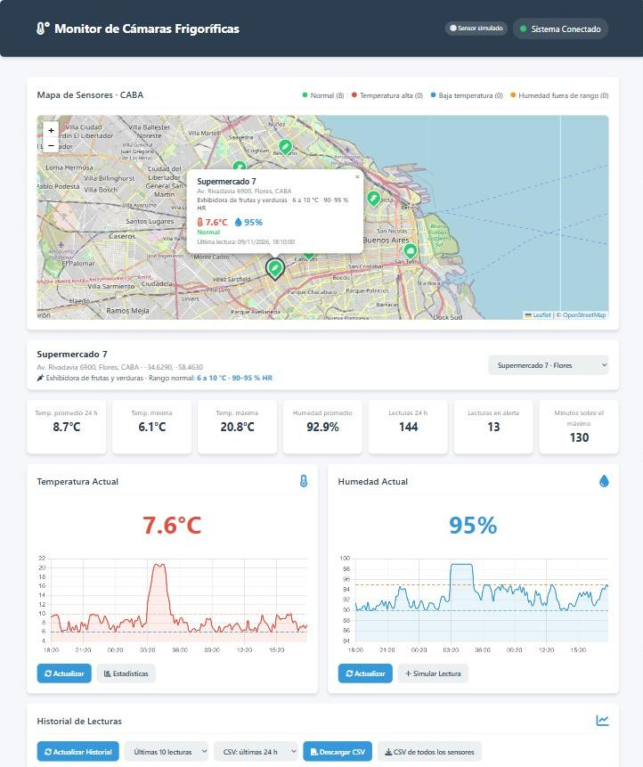

# ❄️ Monitor de Cámaras Frigoríficas — Dashboard IoT

Dashboard web para monitorear en tiempo real la **temperatura y humedad** de las cámaras frigoríficas
de 8 supermercados de la Ciudad de Buenos Aires, con **mapa de sensores**.
Backend en **Python / Flask** con API REST y base **SQLite**; frontend en **HTML + CSS + JavaScript**
con **Chart.js** y **Leaflet / OpenStreetMap**.

> 🔗 **Demo en vivo:** https://monitor-camara-frigorifica.onrender.com
> *(plan gratuito: la primera carga tras un rato sin visitas puede tardar unos segundos)*

[](https://monitor-camara-frigorifica.onrender.com)

Por defecto el backend **simula los sensores**: una lectura cada 10 minutos que varía al azar dentro del
rango normal de cada tipo de equipo, y cada tanto una **falla** (el equipo deja de enfriar) que lleva la
temperatura por encima del rango durante 40–120 minutos y dispara la alarma. Un sensor real (ESP32,
gateway LoRaWAN/Sigfox, etc.) puede enviar lecturas por HTTP al mismo endpoint.

### Rangos por tipo de equipo

Basados en las pautas del Código Alimentario Argentino para heladeras y exhibidoras de supermercados:

| Equipo | Temperatura | Humedad relativa | Sensores |
|---|---|---|---|
| Heladera de lácteos y fiambres | 2 a 5 °C | 70–85 % | Supermercado 1 y 5 |
| Heladera de carnes, pollos y pescados | 0 a 2 °C | 70–85 % | Supermercado 2 y 6 |
| Exhibidora de frutas y verduras | 6 a 10 °C | 90–95 % | Supermercado 3 y 7 |
| Cámara de congelados | −20 a −15 °C | 75–90 % (*) | Supermercado 4 y 8 |

(*) La humedad de congelados no está en la referencia; es un valor asumido.

Alarmas: **Temperatura Alta** si supera el máximo (el equipo no enfría), **Baja Temperatura** si baja del mínimo
(salvo congelados) y **Humedad fuera de rango**. El Supermercado 5 tiene un equipo con fallas frecuentes.

## Funcionalidades

- Mapa de CABA con un marcador por supermercado, coloreado según su estado (normal / temperatura alta / baja).
  Al hacer clic se ve nombre, dirección, temperatura y humedad, y el dashboard pasa a mostrar ese sensor.
- Selector de sensor; el ícono de cada marcador indica el tipo de equipo.
- Descarga de lecturas en **CSV** (sensor elegido o todos; 24 h, 3 o 7 días), listo para Excel en español
  (separador `;`, coma decimal).
- Temperatura y humedad actuales, con alarma cuando el equipo sale de su rango normal.
- Gráficas de las últimas 24 h con líneas de máximo y mínimo del equipo.
- Panel de estadísticas de 24 h: promedio, mínima, máxima, cantidad de lecturas y lecturas en alerta.
- Historial de las últimas N lecturas, con ID de dispositivo y tipo de lectura (programada / a demanda).
- Botón "Leer sensor" (lectura a demanda) y refresco automático cada 30 s.
- Ingesta de sensores reales protegida con API key.

## Arquitectura

```
 Sensores (ESP32 / gateway) ─POST /api/add-reading──┐
                                                    ▼
 Navegador ◀──── HTML + JSON ──── Flask (gunicorn) ──── SQLite
                                     │
                                     └─ Simulador "perezoso": en cada request completa
                                        las lecturas faltantes (cada 10 min) hasta ahora
```

La simulación no usa un hilo en segundo plano: en cada request se generan las lecturas que faltan desde la última
guardada. Así el historial queda continuo aunque el hosting gratuito duerma el servicio por inactividad.

## API

| Método | Endpoint | Descripción |
|---|---|---|
| GET | `/` | Dashboard |
| GET | `/api/health` | Health check |
| GET | `/api/sensors` | Sensores con ubicación (lat/lng, dirección) y última lectura |
| GET | `/api/current-reading?sensor=ID` | Última lectura del sensor |
| GET | `/api/history?sensor=ID&limit=N` | Últimas N lecturas (máx. 500) |
| GET | `/api/readings-range?sensor=ID&hours=24` | Serie para gráficas (promediada) |
| GET | `/api/stats?sensor=ID` | Estadísticas de las últimas 24 h |
| GET | `/api/export.csv?sensor=ID\|all&hours=24` | Descarga CSV |
| GET | `/api/equipment` | Tipos de equipo y sus rangos |
| POST | `/api/add-reading?sensor=ID` | Sin body: lectura simulada · Con JSON: lectura de sensor real |

Si se omite `sensor`, se usa el sensor 1.

Enviar una lectura real:

```bash
curl -X POST https://<tu-servicio>.onrender.com/api/add-reading \
  -H "Content-Type: application/json" \
  -H "X-API-Key: <INGEST_API_KEY>" \
  -d '{"sensor_id": 3, "temperature": -18.4, "humidity": 66}'
```

## Correr en local

```bash
cd backend
python -m venv venv && source venv/bin/activate   # Windows: venv\Scripts\activate
pip install -r requirements.txt
python app.py
# abrir http://localhost:5000
```

Tests: `python -m unittest discover tests` (desde la raíz del proyecto).

## Deploy en Render (gratis)

1. Subir este proyecto a un repositorio de GitHub.
2. En [render.com](https://render.com): **New → Blueprint**, elegir el repo. Render lee `render.yaml` y crea el servicio.
3. Al terminar el build, la URL pública queda en el panel del servicio. La `INGEST_API_KEY` se genera sola
   (pestaña *Environment*).

Notas del plan gratuito: el servicio se duerme tras ~15 min sin visitas y la primera carga tarda unos segundos;
el disco es efímero, así que la base se reconstruye con 24 h simuladas en cada redeploy.

También incluye `Dockerfile` (Fly.io, Google Cloud Run, Railway) y `Procfile` (Railway / Heroku).

## Variables de entorno

| Variable | Default | Uso |
|---|---|---|
| `PORT` | `5000` | Puerto HTTP |
| `DATABASE_PATH` | `backend/sensor_data.db` | Ruta del archivo SQLite |
| `SIMULATION_ENABLED` | `true` | `false` para mostrar solo datos de sensores reales |
| `SIM_INTERVAL_SECONDS` | `600` | Intervalo entre lecturas simuladas |
| `RETENTION_DAYS` | `7` | Días de historial que se conservan |
| `INGEST_API_KEY` | *(vacío)* | Si está definida, se exige en `X-API-Key` para lecturas reales |

## Stack

Python 3 · Flask · gunicorn · SQLite · HTML5 / CSS3 / JavaScript · Chart.js · Leaflet · OpenStreetMap · Font Awesome · Render / Docker

> Las direcciones y coordenadas de los supermercados son ilustrativas.
